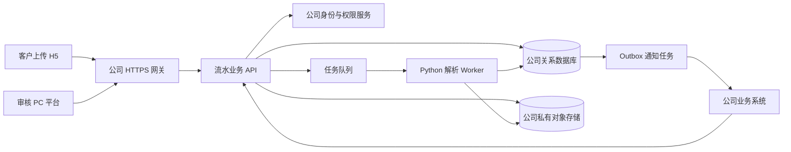

# 03 · 架构与部署

本章描述待开发的生产架构。当前代码只能按 01 的方式演示；仓库没有现成生产 Docker、数据库迁移、Worker 或鉴权配置，不能把“上传服务器后运行 http.server”当作完成部署。

## 1. 方案比较与建议

| 方案 | 优点 | 成本与局限 | 本稿意见 |
| --- | --- | --- | --- |
| 公司后端 + 独立 Python Worker | 保留已校验算法；公司继续管理权限、业务和数据库；解析可独立扩容 | 需定义任务、结果和版本契约 | 推荐 |
| 全部并入 Python 服务 | 研发较少时边界简单 | 若公司使用其他语言，可能重复建账号和业务能力 | 公司已以 Python 为主时可选 |
| 全部改写为公司后端语言 | 运行时一致 | 解析与金额逻辑需重做、回归成本高 | 一期不建议 |

不默认新增 Kubernetes、独立登录体系或多个业务微服务。优先复用公司的网关、SSO、数据库、对象存储、队列、监控；实际产品和版本由公司现有环境决定。

## 2. 目标拓扑

图中 API 和 Worker 访问数据库的权限分开：API 管理业务绑定、授权、会话和发布；Worker 仅操作其被分配任务的解析暂存与结果，不修改公司客户主数据。公司若禁止 Python 直连业务库，可将结果提交到内部结果接口，由公司后端事务入库；应保证 04/05 的数据语义相同。

对象存储保存原文件和受控结果快照，数据库保存业务关联、逐笔结构化记录、指标、版本、审计与对象引用。仅把 HTML 链接写数据库不满足“数据落到公司的数据库”。

## 3. 每次生成如何完成

1. API 校验业务归属、采集会话、授权和限额，上传到隔离暂存区，确认落盘/对象写入成功。
2. 数据库写文件元信息与接收状态，事务写任务事件；独立投递器把事件发到队列，避免“数据库提交了但任务没发出去”。孤立暂存对象按 TTL 清理。
3. Worker 领取有租约的任务，在独立临时目录中解压、检测、解析；每阶段记录耗时和结果码。CPU/内存/页数/超时受限，不能在 Web 请求中运行长解析。
4. 文件成功后固化解析产物和身份核验结果；材料齐备触发新的报告生成任务，锁定输入修订号、所选文件与各规则版本。
5. 新报告计算全部指标与命中明细，校验金额和引用完整性，写暂存结果，生成完整性摘要。
6. 同一数据库事务发布 `READY` 报告并更新当前版本指针、写通知 outbox。只有当前输入修订匹配且未撤销，才可更新最新指针；过期任务可留历史结果，但不能覆盖新版本。
7. 回调业务系统；回调失败不影响报告已经可用。消费者按事件 ID 幂等，失败进入重试或人工处理。

队列按“可能重复投递”设计；数据库中任务、文件、报告发布都必须幂等。Worker 崩溃后租约超时再领取，不能让业务单永久卡在处理中。删除或撤销需使旧任务的发布条件失败。

## 4. 部署环境及服务清单

| 单元 | 开发需要交付 | 网络/数据要求 |
| --- | --- | --- |
| 前端静态资源 | PC 平台模块、客户 H5 构建产物 | 可缓存不含个人数据的 JS/CSS；报告数据不入公共 CDN 缓存 |
| 流水 API | 公司栈服务或模块、接口契约、迁移 | 网关后运行；SSO、会话与业务权限 |
| Python Worker | 可构建镜像、统一入口、锁定依赖、资源限制 | 内网；不接受公网请求；原文件不发第三方 |
| 数据库 | 04 对应 DDL、索引、迁移/回退 | 公司托管、专用账号、最小权限 |
| 对象存储 | 私有桶/前缀、加密、生命周期 | 公共 ACL 禁止；随机对象键，不用姓名命名路径 |
| 队列/任务投递器 | 持久队列、租约、重试、死信监控 | 复用公司消息设施；故障可重放 |
| 通知任务 | Outbox 扫描与回调、人工补发入口 | 出站只允许登记的公司地址 |
| 运维任务 | 临时文件清理、凭据清理、保留期清理 | 清理任务有独立审计及失败告警 |

开发/测试/生产必须分开账号、数据库、对象桶、队列和密钥。生产数据不默认复制到测试。密钥进入公司密钥管理，不能写镜像、Git、报告或 `.env.example`。

## 5. 配置清单（待开发配置契约）

以下变量仅为部署交接建议，不是当前 `collector/config.py` 已支持的配置。

| 配置组 | 内容 |
| --- | --- |
| 业务身份 | 公司系统地址、服务身份、SSO 发行者/受众、授权接口、可信组织范围 |
| 存储 | 数据库连接、私有桶、前缀、加密密钥引用、短期原件访问有效期 |
| 队列 | 连接、队列名、并发、租约/心跳、重试/死信策略 |
| 解析 | 支持模板版本、规则版本、单文件/解压/页数/行数/执行时限 |
| 会话 | 采集链接有效期、闲置超时、Cookie 域及 SameSite、CSRF、验证码限流 |
| 网络 | 域名、TLS、网关请求体限制、上传超时、可信代理地址 |
| 治理 | 文件/交易/报告/审计保留期限、密码 TTL、删除任务、备份保留策略 |
| 运维 | 日志级别、监控地址、告警接收组、回调密钥引用、功能开关 |

建议待验证初值：上传 100 MiB；解压总大小 300 MiB；压缩包条目不超过 20 个、禁止嵌套压缩包、最多一个有效账单；每份 PDF 不超过 500 页、每份账单不超过 50,000 行；单文件解析 5 分钟超时。达到阈值返回可解释错误，不截断后成功。初值需用公司真实版式和峰值压测修订。

## 6. 部署实施步骤

1. 确认域名、部署区域、TLS、客户入口可达性、公司安全要求及域名办理事项；国内访问/备案事项由公司运维核定，不将某个办理动作等同微信一定可打开。
2. 按 06 完成接口、身份、数据库与容量评审，固定代码提交、运行时版本、依赖锁和规则包，生成可重复构建镜像。统一 Python 版本后跑全部回归。
3. 创建私有存储、数据库账号、队列、密钥；执行向后兼容的数据库迁移，备份原数据库。
4. 部署 API、Worker、通知和清理任务，配置网关仅暴露必要接口；关闭源码、模板、样本、输出目录的静态映射。
5. 配置健康检查：进程存活；API readiness 检查必要依赖；Worker 心跳/租约/积压单独监控。健康响应不显示连接串和凭据。
6. 先部署测试环境，用授权样本完成上传→补密码→两平台齐备→入库→报告→回调→权限的闭环，真机检查 H5。
7. 验证备份恢复、任务中断恢复、跨组织越权、文件大小限制与删除生效，再在小范围业务单灰度。
8. 灰度成功后放量，保留上一服务/规则版本和可逆开关。数据库采用兼容迁移；不能简单回退代码而读不兼容的新表。

不提供未经适配的生产部署命令。开发交付时应补上公司实际 registry、命令、域名、配置引用、迁移顺序和回滚步骤，运维能在干净测试环境复现才算部署交付完成。

## 7. 文件与报告访问要求

扩展名白名单、内容类型检测、随机存储名、大小限制、隔离解析和解压路径检查共同执行；上传后不能直接信任文件。ZIP 禁止绝对路径、`..`、符号链接和越界写入，按解压后的实际字节持续限额。依据为 [OWASP 文件上传指引](https://cheatsheetseries.owasp.org/cheatsheets/File_Upload_Cheat_Sheet.html)。

每次列表、详情、明细、源文件访问均执行对象级权限检查；知道报告 ID 或旧链接不获得权限。默认拒绝并验证资源归属，参考 [OWASP 授权指引](https://cheatsheetseries.owasp.org/cheatsheets/Authorization_Cheat_Sheet.html)。

报告接口与原件响应设 `Cache-Control: private, no-store`，禁止搜索引擎索引。报告中的商户、备注等按文本转义，不可当 HTML 执行；表格导出若后续启用需处理公式注入。API 不能接受任意文件 URL 让 Worker 下载，只使用本系统生成的对象 ID。

解压密码使用短期加密存储，Worker 按任务读取。建议文件解析成功或终止后立即清除，待补密码凭据最长 24 小时；过期需重新输入。清除后重新解析加密材料可能需要客户补密码，不应为重跑无限保留密码或长期保存明文解压副本。内存、日志、临时目录和备份策略共同纳入清理设计。

原件查看推荐经过鉴权代理流式传输，以便即时撤销；若使用短期签名 URL，必须说明有效期内无法保证即时撤销，并提供公司认可的期限。客户采集链接完全不能访问报告或原件。

## 8. 运维、容量与故障

建议初测资源为 API/业务模块独立运行，解析 Worker 从 4 vCPU / 8 GiB、并发 1 起测；非容量承诺。PDF 提取内存和耗时受页数、版式影响，按测得的 P95 和峰值到达率调整并发/副本。存储估算：日业务单 × 每单文件数 × 平均字节 × 保留天数，加版本、备份和余量；数据库另估逐笔记录和索引。

监控：入站失败率、待处理最老任务年龄、解析时长/成功率、超时与身份冲突、磁盘/内存、数据库连接、对象失败、回调死信、清理失败。日志只记内部 ID、阶段、错误码、耗时，不记账单正文、证件、密码、上传令牌。

| 故障 | 必须行为 |
| --- | --- |
| 文件存储失败 | 不返回文件已接收；可安全重传 |
| 数据库/队列暂时失败 | 不丢接收记录；outbox 恢复补投，不生成重复报告 |
| Worker 被杀 | 租约超时后恢复；未发布数据不可见 |
| 密码错误/版式未知 | 待补件，不无限重试 |
| 新版本分析失败 | 保留既有成功版本；提示失败尝试 |
| 回调失败 | 保持报告 READY；重试且公司可主动查询 |
| 删除/撤销与任务竞争 | 阻止旧任务重新发布，回收临时数据 |

建议生产可用性目标 99.5%/月、RPO ≤24 小时、RTO ≤4 小时；这些是待公司确认的规划值。若审核业务不能接受该数据损失窗口，采用更密集增量备份/日志恢复并重定成本。数据库与对象版本/清单一起备份，一次恢复演练证明可从业务单追到正确报告和原文件。

## 9. 架构决策记录

| ADR | 决策（提议，待公司技术评审） | 代价/替代方案 |
| --- | --- | --- |
| A01 | 复用 Python 解析，业务和权限由公司后端掌控 | 增加一个运行时；替代是全量重写并重验 |
| A02 | 结构化数据进公司关系库，大文件进私有对象存储 | 需跨存储一致性和清理；优于仅存 HTML 链接 |
| A03 | 异步队列 + 幂等发布 + outbox 通知 | 增加状态管理；避免请求超时与通知丢失 |
| A04 | 不可变报告版本与显式采用版本 | 增加存储；保证审核留痕和规则可重现 |
| A05 | 一期每平台一份有效材料，补件替换 | 不能拼接碎片账期；避免未经验证的跨文件去重 |
| A06 | 鉴权数据驱动 PC 报告，H5 仅采集 | 需拆离内嵌数据；静态独立 HTML 只作本地样稿 |
